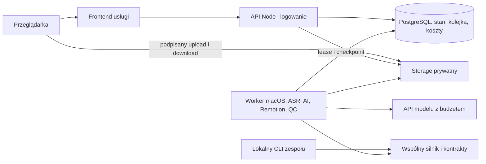

# Serwer MontageFrames — architektura i procedura wdrożenia

Aktualizacja zakresu 2026-10-19: wdrożenie infrastruktury jest odłożone. [Prace do wykonania później i wariant własnego Maca mini](odlozone-uruchomienie.md). Bieżące etapy dotyczą lokalnego silnika i jakości.

Data: 2026-10-18. **Stan: projekt; infrastruktura i nowe polecenia nie są jeszcze wdrożone.** [Założenia](../../zalozenia-funkcji-Serwer.md), [fazy F0–F9](../../plan-wdrozenia-Serwer.md), [rejestr odbioru](acceptance.md).

## 1. Rozmieszczenie

Worker nie przyjmuje publicznych połączeń przychodzących. Łączy się z DB/storage przez prywatną sieć lub kontrolowany kanał. Nie używać prywatnego checkoutu operatora jako katalogu usługi. Każdy job ma osobny workspace i minimalne uprawnienia do potrzebnych danych. Runtime ma własną tożsamość; prawa organizacji egzekwuje API i warstwa zapisu.

Start: jedna instancja API, jeden worker, PostgreSQL także jako kolejka. Lease musi działać między procesami, nie tylko w pamięci. Nie dodawać Redis/Kubernetes ani wielu baz bez wykazanego problemu. Frontend może być statycznie hostowany; API i worker są osobnymi procesami.

## 2. Granice obecnego kodu

| Obecne miejsce | Zastosowanie w usłudze |
| --- | --- |
| `ui/server.mjs`, wtyczka Vite | zachować lokalny adapter, wydzielić wspólne operacje do produkcyjnego API |
| `ui/quickcontent-server.mjs`, `scripts/quickcontent-worker.mjs` | reużyć etapy/checkpointy; wymienić adapter trwałości i uruchamiania w usłudze |
| `scripts/quickcontent-store.mjs`, `ui/reel-store.mjs` | pliki lokalne pozostają; adapter PostgreSQL zachowuje rewizje/409 |
| `scripts/branding-store.mjs`, schemat brandingu | reużyć wersje/snapshoty, dodać organizację i kontrakt reguł |
| `scripts/quickcontent-ai.mjs`, `scripts/quickcontent-edit.mjs` | wspólne operacje; API serwera i lokalne konta to różne transporty |
| `scripts/quickcontent-render.mjs`, kompozycje Remotion | render ze snapshotu i manifestu środowiska/assetów |
| Vision/Swift i CoreText | pierwszy zarządzany worker macOS; Linux wymaga osobnego odbioru |
| `vite.config.mjs` / `build:panel` | build lokalny, nie wysyłać do publicznego hostingu |
| `vite.site.config.mjs` / `build:site` | obecny publiczny landing; nie jest usługowym panelem/API |
| planowany `vite.service.config.mjs` / `build:service` | panel usługi z allowlistą publicznych zasobów i adresem API |

Publiczny build nie kopiuje katalogu `public/`. Nazwy prywatnych klientów/rolek, ich materiały ani rejestr Studio nie mogą trafić do paczki przez statyczny import. Bundle renderera i jego zasoby są oddzielnym prywatnym artefaktem wydania.

## 3. Minimalny model danych i API

Planowane tabele `001_core.sql`: `organizations`, `memberships`, `service_access_grants`, `projects`, `project_revisions`, `branding_revisions`, `assets`, `renders`, `reviews`, `audit_events`. `002_jobs_budget.sql`: `jobs`, `job_attempts`, `checkpoints`, `outbox`, `budget_reservations`, `usage_receipts`. `003_entitlements.sql`: plany/uprawnienia i deduplikacja zdarzeń rozliczenia.

Każdy zasób ma `org_id`; odwołania projekt→asset/profil/job wymuszają tę samą organizację, także w kluczach obcych. Grant pracownika serwisu jest czasowy, zakresowy, odwoływalny i audytowany. Cache ma `org_id` w kluczu. Historyczne rewizje/rendery są niezmienne; `revision` i `input_signature` określają aktualność.

Planowane API `/api/v1`: sesja/organizacja, projekty, brandingi/wersje, uploady, zlecenia/etapy, rewizje, rendery/przeglądy i pobrania. Używać ID w kontekście uprawnionej organizacji, nie globalnego sluga rolki. Lokalne `/api/reel/:name` pozostaje adapterem zgodności, nie publiczną ścieżką do dysku.

Zapis wymaga `baseRevision`; 409 nie nadpisuje draftu. Enqueue wskazuje rewizję, podpis wejścia i klucz idempotencji. Job i outbox powstają transakcyjnie. Claim nadaje lease i rosnący token. Każdy checkpoint/publikacja wykonuje warunkowy zapis względem aktywnego tokena. Sam PID nie wystarcza dla zdalnych workerów.

Upload: rekord i rezerwacja przestrzeni → podpisy części → wysłanie → complete z checksum → `ready`. Niepełny plik nie uruchamia analizy; osierocone części sprząta osobny etap po ustalonym czasie. Download: autoryzacja → krótko ważny podpis, bez publicznego bucketu.

## 4. Środowiska i konfiguracja

Oddzielne local/staging/production: własne DB, storage, logowanie, sekrety i limity. Nie kopiować domyślnie prywatnych danych produkcji na staging. Logi zawierają ID etapów/rewizji i zredagowane błędy, bez sekretów i pełnej transkrypcji.

Planowane `ops/service.env.example` zawiera tylko placeholdery:

| Obszar | Nazwy konfiguracji planowanej |
| --- | --- |
| Tryb/adresy | `MF_MODE`, `MF_PUBLIC_ORIGIN`, `MF_API_ORIGIN` |
| Baza | `MF_DATABASE_URL` z TLS i ograniczoną rolą usługi |
| Logowanie | `MF_OIDC_ISSUER`, `MF_OIDC_CLIENT_ID`, `MF_OIDC_CLIENT_SECRET`, `MF_SESSION_SECRET` |
| Storage | `MF_STORAGE_ENDPOINT`, `MF_STORAGE_BUCKET`, `MF_STORAGE_REGION`; poświadczenia poza repo |
| Worker | `MF_WORKER_ID`, `MF_WORKER_WORKSPACE`, `MF_RUNTIME_MANIFEST` |
| Limity | równoległość globalna 1; zatwierdzone limity organizacji, mediów i kosztu |
| AI | obecny provider API i klucz tylko na serwerze; lokalne account-only niezależne |

Zmienne `MF_*` to projekt, nie obecnie obsługiwana konfiguracja. Sekrety w magazynie danego hosta. OIDC sprawdza issuer/audience/state/nonce; cookie sesji Secure/HttpOnly, ograniczone SameSite i ochrona CSRF. Osobne origin frontend/API wymagają jawnej allowlisty oraz sprawdzenia sesji/uploadu, nie `*` z credentials.

## 5. Pierwsze wdrożenie

1. Uzupełnić decyzje z [rejestru](acceptance.md): budżet, hosting/region, limity danych, retencja/kopie/usuwanie, logowanie, dostęp serwisu i zasoby dopuszczonych profili. Plan nie wybiera abonamentu ani nie przenosi danych.
2. Zamrozić release: Git SHA, lockfile, manifest runtime/assetów, migracje i dopuszczone profile z odbiorem. Budować z czystego checkoutu, bez prywatnych rolek.
3. W przygotowanym środowisku wykonać `npm ci`, `npm test`, `npm run lint`, `npm run build:site`; po F5 także `npm run build:service`. Obie publiczne paczki mają kontrolę allowlisty. `build:panel` pozostaje lokalny.
4. Przygotować staging: TLS, zaproszenia, prywatne DB/storage, role, podpisy i sieć workera. Publiczne wystawienie Vite przez `0.0.0.0` nie zastępuje usługi.
5. Zastosować migracje po kopii/dry-run. Rozszerzać schemat kompatybilnie z poprzednią wersją; nie usuwać starej kolumny w deployu, który dopiero przełącza klientów.
6. Uruchomić API, potem worker. Wykonać preflight fontów/assetów, ASR/narzędzi, pamięci i dysku na konkretnym Macu. Brak API dla SaaS nie uruchamia osobistego CLI ani innego płatnego provider.
7. Przejść F5–F7: dwie organizacje, rzeczywisty upload/YouTube, wersje/poprawki, zamknięcie karty, restart/lease, usage przed błędem odpowiedzi, render/odsłuch/pobranie, rollback i restore. Wyniki wpisać do rejestru, nie tylko CI.
8. Importować wybrane projekty przez dry-run i kopię, bez nadpisywania lokalnych danych. Stare MP4 pozostają; niedostępny stary runtime oznacza jawne ograniczenie ponownego renderu.
9. Włączyć zamknięty pilot odebranych profili, jedną ciężką pracę i pełny przegląd. Zmiana reguł/runtime wymaga ponownego korpusu. Publiczna sprzedaż ma osobne warunki F8.

## 6. Kontrola, koszty i odzyskiwanie

Oddzielić `rendered`, `automaticCheck=pass|fail|unknown` i `humanReview=pending|approved|changesRequested`. UI pokazuje rzeczywiste etapy/render%, bez wymyślonego postępu LLM. Wcześniejszy sprawdzony film pozostaje dostępny z wersją.

Metryki: kolejka/etapy p50/p95, lease/timeouty, dysk, błędy QC per profil/runtime, AI input/output/cache/reasoning i próby, koszt zaakceptowanego filmu/poprawki, CPU/render/storage/transfer, minuty przeglądu. Alarmy kalibrować pilotem; limit wydatków egzekwować od pierwszego requestu.

| Zdarzenie | Procedura |
| --- | --- |
| Utrata odpowiedzi AI | utrwalić próbę/stan kosztu, sprawdzić checkpoint/response ID; bez dowodu brak automatycznej kolejnej opłaty, stan `needs_action` zachowuje draft |
| Błąd renderu | zachować checkpoint AI; retry tylko renderu, wadliwy MP4 nie dostaje aktualnego badge |
| Utrata workera | przejęcie po lease, stary token odrzucony przy każdym zapisie; sprzątać tylko własne procesy/workspace |
| Wadliwy runtime/profil | zatrzymać nowe joby danej wersji, wycofać do poprzedniego builda; zachować wyniki/usage, wstrzymać niezgodne joby zamiast uruchamiać starym kodem |
| Restore | odtworzyć DB, media i manifest razem w osobnym środowisku; sprawdzić hashe i brak podwójnego wznowienia; sama kopia DB nie wystarcza |
| Usunięcie danych | anulować joby, odebrać dostęp, usunąć źródła/pochodne/cache zgodnie z polityką, jawnie uwzględnić backupy i ich rotację |

Częstotliwość kopii, RPO/RTO, retencję, TTL podpisów i limity przestrzeni ustalić przed pilotem. Przekroczenie przestrzeni blokuje upload, nie kasuje materiałów automatycznie. Nie są to obecnie wdrożone SLA.

## 7. Lokalny CLI i późniejszy Linux

Release usługi musi zachować lokalny panel, `reel:check`, CLI QC i account-only bez API. Lokalny test nie wymaga organizacji/abonamentu SaaS. Billing i logowanie są adapterami wokół wspólnego silnika; kontrola jakości dotyczy wybranego kontraktu w obu trybach.

Linux to osobny plan F9: zamiana Vision/CoreText, przypięty obraz/digest/architektura, korpus per profil i pomiar opłacalności. To samo JSX ani uruchomienie FFmpeg nie dowodzi zgodności fontu, detekcji i klatki.
