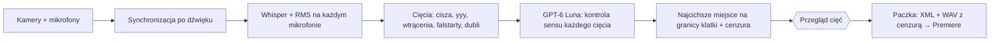

# Założenia funkcji CutRaw — cięcie surowego nagrania (podcast, multicam) → XML do Premiere

Data: **2026-10-23**. Stan (2026-10-24): **C1 (terminal: `npm run cutraw`) i C2 (panel: CutRaw w menu, `#cr`) zrobione i sprawdzone na danych syntetycznych; import w Premiere i prawdziwy podcast to C0** ([odbiór](docs/cutraw/acceptance.md)). Kontrakt wspólny dla Claude Code i Codex.

Powiązane: [plan wdrożenia](plan-wdrozenia-CutRaw.md) · [LongForm](zalozenia-funkcji-LongForm.md) (CutRaw używa jego silnika rough cut) · [Premiere](zalozenia-funkcji-Premiere.md) · [PREFERENCJE.md](PREFERENCJE.md) → „CutRaw” · [AGENTS.md](AGENTS.md).

## 1. Efekt dla użytkowniczki

Wrzucam 1, 2 lub więcej plików z kamer i opcjonalnie osobne audio MP3/WAV z 1–2 mikrofonów. Wybieram klienta (opcjonalnie) i tempo cięć. Klikam „Przetwarzaj”. CutRaw:

1. **synchronizuje** wszystkie źródła po dźwięku (bez klapsa i timecode'u);
2. **odsłuchuje** mowę: transkrypcja słowo po słowie (lokalnie) i poziom dźwięku co 10 ms na każdym mikrofonie;
3. **proponuje cięcia**: cisza, „yyy/eee/aaa/mmm”, wtrącenia („no”, „jakby”, „w sensie”) tylko gdy są pustymi wtrąceniami, falstarty, dubli i zbędne powtórzenia;
4. **GPT‑6 Luna sprawdza każde cięcie** pod kątem sensu: czy zdanie po cięciu ma ręce i nogi, czy nic ważnego nie znika. Wątpliwe cięcie wraca, treść nie znika;
5. ustawia każde cięcie **w najcichszym miejscu** między słowami, na granicy klatki;
6. **cenzuruje przekleństwa** PL i EN: słychać pierwsze 1–3 litery (domyślnie 2), reszta wyciszona; opcjonalnie wraca ostatnia litera;
7. pokazuje **przegląd cięć** (odsłuch, przywracanie, własne cięcie z zaznaczenia tekstu);
8. eksportuje **paczkę do Premiere**: plik XML (Final Cut Pro 7 XML) + audio z cenzurą. W Premiere: Plik → Importuj → `.xml` i pracuję dalej na osi.



Wynikiem CutRaw jest **oś w Premiere**, nie render MP4. Napisy, efekty i rolki robią dalej LongForm / QuickContent.

## 2. Zasady nadrzędne

- **Ręce i nogi.** Usuwamy tylko słowa i przerwy na granicach słów, nigdy nie zmieniamy kolejności. Nie znika przeczenie, warunek, liczba, nazwa własna ani zastrzeżenie (walidator `validateCuts` z LongForm). Wątpliwe = zostaje. Lepiej zostawić „yyy” niż urwać myśl.
- **Cięcia mogą być częste, ale nie na siłę.** Domyślne tempo „standard” tnie ciszę od 0,40 s i zostawia oddech 0,12 s. Śmiech i reakcja rozmówcy na treść nie są wtrąceniem.
- **Podcast = wspólna oś.** Cięcie usuwa ten sam czas ze wszystkich źródeł naraz (synchronizacja się nie rozjeżdża). Cisza liczy się tylko wtedy, gdy milczą **wszystkie** mikrofony. Nie tniemy, gdy ktokolwiek mówi.
- **Najcichsze miejsce.** Krawędź cięcia wybieramy spośród granic klatek w dozwolonym oknie (od końca ostatniego zachowanego słowa do początku następnego, ±60 ms od propozycji) i bierzemy tę z najniższym RMS sumy mikrofonów. W sąsiednie słowo wolno wejść najwyżej o pół klatki, bo Whisper podaje słowa stykające się bez przerwy. Cięcie krótsze niż klatka = „do decyzji”.
- **Dubel to ta sama osoba.** Podobne zdanie rozmówcy nie jest dublem. Reguła w kodzie (`sameSpeaker`), niezależna od odpowiedzi modelu.
- **Oryginały nietknięte.** Źródeł nie kopiujemy ani nie nadpisujemy. XML wskazuje oryginały po ścieżce. Nowe pliki (audio z cenzurą, XML) trafiają do osobnej paczki z wersją `vNNN`.
- **AI jawnie i tanio.** Domyślny redaktor CutRaw to **GPT‑6 Luna** przez OpenAI API (decyzja użytkowniczki 2026-10-23, `quickcontent-ai.mjs`, provider `openai`). Do modelu idzie wyłącznie tekst transkrypcji z czasami, nigdy audio ani wideo. Alternatywa: operator na koncie (Claude Code / Codex CLI). Tryb `MONTAGEFRAMES_ACCOUNT_ONLY=1` blokuje API zgodnie z zasadą 2026-10-18. Brak odpowiedzi AI = zostają cięcia deterministyczne + czytelny komunikat; **bez cichego przełączania na inny płatny model**. Zużycie tokenów i koszt zapisujemy zmierzone, brak danych ≠ 0.
- **Klient przed ogólnymi zasadami.** `klienci/<klient>/PREFERENCJE.md` ma pierwszeństwo (np. SkyClass: bez cięcia ciszy i wtrąceń, tylko ręcznie zatwierdzone dubli).
- **Uczciwe deklaracje.** Nie deklarujemy synchronizacji, gdy pewność jest niska, ani działania importu w wersji Premiere, której nie sprawdziliśmy.
- **Zlecenie z GUI** kończy się stanem i podsumowaniem po polsku w panelu, bez pytań, commitów, wysyłki i publikacji.

## 3. Zakres MVP i poza zakresem

**MVP:** 1–4 kamery + 0–2 osobne mikrofony (MP3/WAV), mowa po polsku z angielskimi wtrąceniami, do ~2 h, ten sam fps na wszystkich kamerach (25 / 29,97 / 30 / 50 / 59,94), eksport FCP7 XML. Kamery ułożone na osobnych, zsynchronizowanych ścieżkach (V1 = kamera główna).

**Poza MVP (fazy C3–C4):** automatyczne przełączanie kamer na mówiącego, korekta dryfu zegara między urządzeniami, tryb „Zwięźle” (skracanie redakcyjne), prawdziwa sekwencja multicam Premiere, plugin UXP, render MP4.

## 4. Wejście i synchronizacja

- Rola pliku z typu: wideo → **Kamera**, samo audio → **Mikrofon**. Etykieta do zmiany (np. „Mikrofon — Ania”). Kamera referencyjna (czas mastera = jej czas) domyślnie pierwsza.
- `ffprobe` dla każdego pliku: długość, fps, VFR, rozdzielczość, kanały, sample rate. Różny fps między kamerami lub VFR = ostrzeżenie przed przetwarzaniem.
- **Algorytm (bez nowych zależności, sam Node + FFmpeg):** każde źródło → mono 16 kHz → obwiednia log‑energii w oknach 10 ms (podejście z polysync: odporne na różne wzmocnienie i akustykę, w przeciwieństwie do surowej korelacji PCM). Korelacja zgrubna na obwiedni zdecymowanej do 20 Hz (cały zakres przesunięć), doprecyzowanie na 100 Hz w ±0,1 s, na końcu PCM 16 kHz w ±10 ms.
- **Pewność:** stosunek najwyższego piku do drugiego piku (jak score w audio-offset-finder: wysoki = pewne, niski = do sprawdzenia). Niska pewność → GUI prosi o ręczne przesunięcie (±1 klatka / ±10 ms) i odsłuch.
- **Dryf:** offset mierzony w 3 oknach (początek, środek, koniec). Różnica > ½ klatki = ostrzeżenie w MVP, korekta w C3.
- Mowa do ASR i RMS: jeśli są mikrofony → ich miks (czystszy dźwięk), w przeciwnym razie audio kamery referencyjnej. Mówca słowa = mikrofon z najwyższym RMS w czasie słowa.

## 5. Redakcja cięć

Reużywamy kategorii LongForm (`kind`: `silence`, `filler`, `false-start`, `retake`, `repetition`, `offtopic`, `manual`) i schematu `Cut` z `src/longform/schema.mjs`.

| Tempo | Cisza od | Oddech na krawędzi |
|---|---|---|
| spokojne | 0,60 s | 0,20 s |
| **standard (domyślne)** | 0,40 s | 0,12 s |
| gęste | 0,28 s | 0,08 s |

- **Deterministycznie:** `silenceCuts`, `voicedGaps` (dźwięk bez słowa — tak łapiemy „yyy”, które Whisper zwykle pomija), `fillerCuts` z `fillers-pl.json`.
- **GPT‑6 Luna, przebieg 1 (propozycje):** falstarty, dubli (zostaje ostatnia pełna wersja), powtórzenia, uwagi „do realizatora”, wieloznaczne wtrącenia. Model zwraca `wordIds`, czasy liczy kod (`EDIT_SCHEMA`, `cutsFromAI`).
- **GPT‑6 Luna, przebieg 2 (kontrola sensu):** dostaje tekst „po cięciach” z zaznaczonymi miejscami cięć i ocenia każde: `cut | keep | undecided` + krótki powód oraz listę miejsc, gdzie zdanie się urywa. `keep` przywraca cięcie. Powtórzenie wycinamy automatycznie tylko przy pewności ≥ 0,85 **i** pozytywnej kontroli, inaczej „do decyzji” (zachowane).
- **Walidator** (`validateCuts`) po obu przebiegach + reguły CutRaw: brak cięcia w trakcie słowa na którymkolwiek mikrofonie, krawędzie na granicach klatek.
- Przejścia: twarde cięcie w najcichszej klatce. Krótkie przenikanie audio (2 klatki) w XML tylko wtedy, gdy spike C0 potwierdzi import przejść w wersji Premiere użytkowniczki. W przeciwnym razie instrukcja: w Premiere zaznaczyć audio → „Zastosuj domyślne przejścia do zaznaczenia”.

## 6. Cenzura

- Wykrywanie: `profanity-pl.json` (jest) + nowy `profanity-en.json`, oba z listą wyjątków (np. „kurek”). Kandydaci z leksykonu idą do Luny z kontekstem zdania; Luna może też wskazać przekleństwo, którego leksykon nie zna (Whisper bywa niedokładny: „je...”).
- Czas: długość słowa dzielona proporcjonalnie na litery. Słychać `keepHead` liter (1–3, domyślnie 2, min. 60 ms, maks. 45% słowa). Wyciszenie do końca słowa + 30 ms, rampy 5 ms. `keepTail: 1` przywraca ostatnią literę. Bez kruka i innych SFX.
- Dokładność: XML jest kwantowany do klatek (40 ms przy 25 fps), więc cenzury **nie** robimy cięciem ani keyframe'ami w XML. Każda ścieżka mowy dostaje nowy plik `*-cenzura.wav` z wyciszeniem co do próbki (`censoredAudioArgs` z `longform-otio.mjs`). Oryginalne audio jest w XML jako wyłączona ścieżka odniesienia, więc w Premiere można je przywrócić.
- Proporcja liter to przybliżenie. Jeśli testy C1 pokażą, że słychać za dużo lub za mało, w C3 dochodzi wyrównanie znak po znaku (forced alignment).

## 7. Eksport do Premiere

- Format: **Final Cut Pro 7 XML (xmeml)**. Premiere importuje go bezpośrednio. FCPXML z Final Cut Pro X Premiere nie czyta. Generator naśladuje XML wyeksportowany z Premiere użytkowniczki (wzorzec z C0), a nie pisany z pamięci.
- Sekwencja: timebase i `ntsc` z kamery referencyjnej, rozdzielczość jak kamera. Na każde zachowane cięcie po jednym `clipitem` na każdej ścieżce. Źródło spoza zakresu czasu danego pliku = brak klipu (luka).
- Ścieżki: **V1** kamera główna, **V2…** pozostałe kamery (wyłączone, zsynchronizowane; Premiere i tak nie importuje prawdziwego multicamu z XML, tylko ścieżki ułożone jedna nad drugą). **A1…** mowa z cenzurą (włączone), dalej oryginalne audio mikrofonów i kamer (wyłączone, do odniesienia).
- Ścieżki plików: `file://localhost/…` z kodowaniem procentowym (spacje, polskie znaki) i escapowaniem XML (`<`, `>`, `&` w nazwach psują import).
- Paczka: `klienci/<klient>/Render/<nazwa>-cutraw-vNNN/` (bez klienta: `out/<nazwa>-cutraw-vNNN/`) z `<nazwa>.xml`, `audio/*.wav` i `README.txt` (jak zaimportować). Poprzednie wersje zostają.

## 8. Panel (C2) — kierunek UX

Tryb **Operate** (Impeccable): narzędzie robocze, czytelność ponad ekspresję, biel + niebieski panelu. Zasady z Apple HIG (`generative-ai.md`, `feedback.md`, `undo-and-redo.md`, `progress-indicators.md`) i Design Taste:

- Jeden ekran, cztery etapy nazwane słowami: **Materiały → Synchronizacja → Cięcia → Eksport**. Etap niedostępny pokazuje powód.
- **Element rozpoznawczy: oś źródeł.** Każde źródło to pas z falą dźwięku, wyrównany po synchronizacji. Cięcia to pionowe pasy przechodzące przez wszystkie źródła naraz, bo dokładnie tak działa cięcie podcastu. Tego nie da się pomylić z edytorem jednej ścieżki.
- Postęp określony, z konkretnym opisem („Synchronizuję Kamerę 2 z Mikrofonem 1 — 62%”), bez animowanego zgadywania (zasada QuickContent).
- AI oznaczone przy każdym cięciu: „Luna: wyciąć, falstart poprawiony w następnym zdaniu”. Obok sterowanie: Przywróć / Wytnij, odsłuch przed i po. Bez okien alertów: status przy elemencie, cofnij ⌘Z / ⇧⌘Z bez limitu.
- Skróty: Spacja, J/K/L, X (wytnij/przywróć), N/P (następne/poprzednie cięcie). Filtry po rodzaju z licznikami, „Przywróć wszystkie: <rodzaj>”, licznik „Wycięto 12:40 z 58:10”.
- Cenzura jako lista: słowo zamaskowane („k***a”), co słychać, suwak liter 1–3, przełącznik ostatniej litery, odsłuch.
- Taste: bez szkła, gradientów, etykiet nad nagłówkami, numeracji 01/02, kart z ikonami i monospace. Czasy w cyfrach tabelarycznych fontu panelu. Jeden akcent niebieski na głównej akcji („Eksportuj do Premiere”).
- Przegląd cięć **reużywa ekranu „Cięcia” z LongForm** (`ui/LongForm.tsx`), rozszerzonego o oś źródeł i mówcę przy słowie.

## 9. Dane i pliki

```text
public/cutraw/<nazwa>/            # stan projektu (gitignore)
  cutraw.json                     # źródła (ścieżka, rola, etykieta, odcisk, offset, pewność, dryf), ustawienia, cięcia z werdyktem Luny, wyciszenia, uwagi, zużycie AI, eksporty, rewizja
  transcript.json                 # słowa w czasie mastera: id (w0…), text, start, end, speaker
  mix.wav, .whisper/              # miks mowy 16 kHz w czasie mastera i cache Whispera
  proxy.mp4                       # podgląd 720p dla panelu (C2)
klienci/<klient>/Render/<nazwa>-cutraw-v001/   # paczka eksportu (bez klienta: out/)
```

Czasy w `cutraw.json` są w **czasie mastera** (kamera referencyjna). Czas źródła = czas mastera − `offset` źródła.

## 10. Co reużywamy (zasada Ponytail)

| Potrzeba | Istniejący kod |
|---|---|
| Transkrypcja z postępem | `scripts/quickcontent-transcribe.mjs` (Whisper `large-v3-turbo`) |
| Cisza, RMS, wtrącenia, cenzura, walidator, decyzje | `scripts/longform-roughcut.mjs`, `src/longform/cuts.mjs`, `src/longform/schema.mjs`, `fillers-pl.json`, `profanity-pl.json` |
| Propozycje AI z `wordIds` | `scripts/longform-ai.mjs` (`EDIT_SCHEMA`, `cutsFromAI`, `editRoughCut`) |
| GPT‑6 Luna, konto CLI, koszty | `scripts/quickcontent-ai.mjs`, `scripts/quickcontent-costs.mjs` |
| Audio z cenzurą | `censoredAudioArgs` w `scripts/longform-otio.mjs` |
| Joby, blokada ciężkiej pracy, postęp | `ui/longform-server.mjs`, `scripts/quickcontent-progress.mjs` |
| Ekran przeglądu cięć | `ui/LongForm.tsx`, `ui/longform-view.mjs` |

Nowe są tylko: synchronizacja, wybór najcichszej klatki, drugi przebieg Luny, litery w cenzurze + `profanity-en.json`, generator XML i orkiestracja CutRaw. Zmiany we wspólnym silniku LongForm muszą przejść testy LongForm.

## 11. Research (2026-10-23)

Ograniczenie z reverse-skill: analiza tylko publicznych informacji. Bez dekompilacji, przechwytywania ruchu czy kopiowania modeli Pleofonu (brak autoryzacji, licencja). Z reverse-skill bierzemy jedynie łańcuch dowód → wniosek.

| Dowód | Wniosek dla CutRaw |
|---|---|
| [Pleofon](https://pleofon.ai): tryb Cleanup (cisza, wtrącenia, nieudane ujęcia) i Digest (redaktor wybiera zdania); transkrypcja z oddechami i zawahaniami; edycja tekstem; odsłuch i przywracanie; globalny suwak tempa; analiza lokalna; eksport „XML”; modele uczone na PL i EN; 120 min/mies. za darmo, 19,99 USD Pro | MVP = Cleanup + bezpieczne dubli; Digest jako „Zwięźle” w C4. Suwak tempa = 3 presety. Na stronie Pleofonu brak synchronizacji multicam i cenzury: to wyróżnik CutRaw |
| Zwykły Whisper pomija wypełniacze; [CrisperWhisper](https://github.com/nyrahealth/CrisperWhisper) je zapisuje, ale konwersja faster-whisper ma licencję [CC BY-NC](https://www.promptlayer.com/models/fastercrisperwhisper), a skuteczność dla PL jest niepotwierdzona | MVP łapie „yyy” z audio (`voicedGaps`) + leksykon. Model verbatim to ewentualnie C3, po sprawdzeniu licencji |
| Synchronizacja: [syncstart](https://pypi.org/project/syncstart/1.0.0) (FFT), [audio-offset-finder](https://pypi.org/project/audio-offset-finder/0.5.1/) (MFCC + score pewności), [MergeSynced](https://github.com/coraxx/MergeSynced), [SyncSink](https://0110.be/posts/SyncSink_-_Synchronize_media_by_aligning_audio), polysync ([opis](https://raw.githubusercontent.com/jianshuo/claude-skills/main/wjs-syncing-multicam/SKILL.md)): obwiednia log‑energii zamiast surowego PCM | Własna korelacja obwiedni w Node (bez Pythona i nowych paczek) + score pewności + pomiar w 3 oknach |
| Premiere importuje FCP7 XML bezpośrednio ([Adobe](https://helpx.adobe.com/si/premiere-pro/how-to/migrate-from-final-cut-pro.html)); multicam przez XML wchodzi jako zwykła sekwencja ([forum Adobe](https://community.adobe.com/t5/premiere-pro-discussions/can-i-import-a-multicam-clip-via-xml-into-premiere-pro/m-p/15334468)); znaki `<` `>` w ścieżkach psują import ([forum](https://community.adobe.com/t5/premiere-pro/import-xml-not-working/m-p/9665460)); gain klipu do +6 dB ([Larry Jordan](https://larryjordan.com/articles/fcp-7-move-projects-to-premiere-pro/)); brak pewnego źródła, że keyframe'y głośności z FCP7 XML przeżywają import | Ścieżki ułożone jedna nad drugą zamiast multicamu; escapowanie ścieżek; cenzura w WAV, nie w keyframe'ach; spike importu w C0 na wersji użytkowniczki |

## 12. Kryteria odbioru MVP

Na prawdziwym podcaście 2 kamery + 2 mikrofony (≥ 20 min) i na nagraniu z 1 kamery:

1. Błąd synchronizacji ≤ 1 klatka na początku, w środku i na końcu (sprawdzone odsłuchem i obrazem). Pewność widoczna, niska pewność oznaczona.
2. XML importuje się w wersji Premiere użytkowniczki bez błędów: wszystkie ścieżki zsynchronizowane, cięcia na klatkach, media podpięte (najwyżej Link Media po przeniesieniu plików).
3. Żadne cięcie nie wypada w środku słowa na żadnym mikrofonie. Na 20 losowych cięciach brak słyszalnego kliku i urwanego oddechu.
4. Każde cięcie ma rodzaj, powód i werdykt Luny. Przywrócenie dowolnego cięcia działa. Odsłuch całości: zdania kompletne, sens bez zmian (przegląd ręczny).
5. Cenzura: słychać ustawioną liczbę liter, reszta słowa cisza, PL i EN. Słowa z listy wyjątków nie są wyciszone.
6. Oryginalne pliki bez zmian (hash przed i po), poprzednie wersje paczek zostają.
7. Zmierzony koszt Luny zapisany w projekcie. Brak klucza lub tryb account-only → cięcia deterministyczne + jasny komunikat, bez płatnego fallbacku.

## 13. Otwarte decyzje (domyślne do czasu odpowiedzi)

- Wersja Premiere użytkowniczki → potrzebna do spike'u C0 (domyślnie: aktualna 2026).
- Auto‑przełączanie kamer na mówiącego → domyślnie C3, w MVP kamery na osobnych ścieżkach.
- Cenzura: domyślnie 2 pierwsze litery, ostatnia litera wyłączona.
- Audio kamer w XML: domyślnie wyłączone ścieżki odniesienia, gdy są mikrofony.
