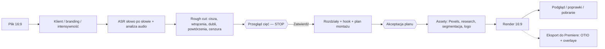

# Założenia funkcji LongForm — montaż poziomy „gadającej głowy”

Data założeń: **2026-10-15**. Stan: **plan — nic z tego dokumentu nie jest jeszcze zaimplementowane.** To kontrakt funkcji, wspólny dla Claude Code i Codex.

Powiązane: [plan wdrożenia](plan-wdrozenia-LongForm.md) · [research i źródła](docs/longform/research.md) · [katalog efektów](docs/longform/efekty.md) · [GUI](docs/longform/gui.md) · [integracja z Premiere Pro](zalozenia-funkcji-Premiere.md) · [instrukcje agentów](AGENTS.md).

## 1. Efekt dla użytkowniczki

Wgrywam poziome nagranie (16:9), w którym ktoś mówi do kamery. Wybieram klienta i jego branding. Klikam „Przetwarzaj”. Program sam:

1. wycina ciszę, „yyy/eee/aaa”, falstarty, dubli i zbędne powtórzenia — tak, żeby sens każdego zdania i całego filmu pozostał bez zmian;
2. cenzuruje przekleństwa: wycisza do zera ok. 80% słowa (pierwsza głoska zostaje słyszalna) i w tym miejscu odtwarza dźwięk kruka;
3. **zatrzymuje się i daje mi pocięty materiał do przejrzenia.** Widzę każde cięcie z powodem, mogę je cofnąć, dodać własne, zatwierdzić.

Dopiero po moim „Zatwierdź cięcia” program:

4. dzieli film na rozdziały (wstęp, części merytoryczne, puenta/CTA) i rozpoznaje, gdzie kończy się wstęp;
5. planuje montaż: angażujący wstęp (hook, gęste efekty), potem spokojniejszy, ale żywy rytm w rozdziałach — napisy kinetic, zoomy, przebitki z Pexels, grafiki danych, porównania, logotypy, efekty z wycięciem osoby, przejścia na cięciach;
6. robi research tego, o czym mówi autor, i dokłada wizualizacje, które **doedukowują widza** (dane ze źródłem, procesy, porównania);
7. wszystko w brandingu i preferencjach wybranego klienta;
8. pokazuje plan montażu do akceptacji, renderuje, a ja poprawiam i pobieram — jak w QuickContent.



## 2. Zasady nadrzędne (nie negocjować)

- **Sens nienaruszalny.** Cięcie usuwa tylko słowa lub przerwy; nigdy nie zmienia kolejności zdań, nie skleja połówek dwóch różnych myśli w nową tezę, nie usuwa przeczenia, warunku, liczby, zastrzeżenia ani kontekstu zmieniającego znaczenie. Wątpliwe cięcie = nie tnij, oznacz „do decyzji”.
- **Dwie jawne bramki.** „Przetwarzaj” kończy się na przeglądzie cięć. Montaż efektowy rusza dopiero po „Zatwierdź cięcia”, a render po akceptacji planu (lub „Akceptuj wszystko”).
- **Jeden plan, dwa renderery.** Wynik redakcji i montażu to dane (`reel.json` rozszerzony o format, wyciszenia, rozdziały i efekty). Renderuje je Remotion, a w przyszłości ten sam plan stosuje plugin Premiere. Żadnej logiki montażu „tylko w Remotion”.
- **Klient przed ogólnymi zasadami.** `klienci/<klient>/PREFERENCJE.md` > `PREFERENCJE.md` > `frame.md` > ten dokument. Zakazy treści klienta (np. rejestr medyczny Vital Hormone, compliance GlowUp, kredyt u Ameryki) obowiązują też w researchu i grafikach.
- **Nie zmyślamy.** Liczby, nagłówki, logotypy i fakty tylko z prawdziwych źródeł; podpis „Źródło: …” i `sources.md`. Nie obiecujemy viralowości ani czasu przetwarzania bez pomiaru. Brak działającej detekcji = brak deklaracji efektu.
- **Bez nowego płatnego API.** Analiza i plan przez obecnego operatora AI (Codex/Claude na koncie, `aiProvider`), Pexels przez istniejący darmowy klucz z `.env`, opis publikacji przez GPT‑6 Luna zgodnie z PREFERENCJE.md. Koszty pokazujemy osobno: analiza, plan, poprawki.
- **Master nienaruszony.** Oryginał, zatwierdzone cięcia i poprzednie wersje renderów zostają. Rendery klienta: `klienci/<klient>/Render/<nazwa>-vNNN.mp4`; bez klienta `out/`.
- **Zlecenie z GUI** kończy się stanem i podsumowaniem po polsku w panelu: bez pytań, commitów, wysyłki i publikacji.

## 3. Zakres pierwszego wydania

W zakresie: jeden plik poziomy (lokalny lub master z QuickContent/YouTube), mowa po polsku, 1–3 osoby w kadrze (główny scenariusz: jedna osoba), długość do ~30 min, wynik 1920×1080 lub 3840×2160 przy źródle 4K, fps zgodnie ze źródłem (25/30/50/60).

Poza zakresem v1: wiele kamer z osobnych plików (multicam sync), automatyczna publikacja na YouTube, dubbing, montaż muzyki do beatu, nagrania bez mowy. Pion z gotowego filmu robi QuickContent (może brać gotowy LongForm jako źródło).

## 4. Rough cut — redakcja materiału

### 4.1 Wejście

- ASR słowo po słowie z czasami: istniejące `scripts/quickcontent-transcribe.mjs` (Whisper) lub Parakeet (`hyperframes transcribe`). Każde słowo dostaje stałe `id`.
- Analiza audio: `silencedetect` (jak `scripts/prep.mjs`, próg `NOISE_DB`) oraz RMS co 10 ms — do wykrywania wtrąceń, których ASR nie zapisał, i do miksu SFX.
- Ujęcia/cięcia kamery i twarz: istniejące `scripts/quickcontent-speaker.mjs` + `scripts/quickcontent-face.swift`.

### 4.2 Kategorie cięć

Każde proponowane cięcie: `{ id, start, end, wordIds[], kind, reason, confidence, auto }`.

| kind | Co | Kto decyduje | Domyślnie |
|---|---|---|---|
| `silence` | przerwa ≥ próg (domyślnie 0,45 s; na krawędziach zostaje 0,12–0,2 s oddechu) | deterministycznie | włączone |
| `filler` | „yyy”, „eee”, „aaa”, „mmm”, przeciągnięte „no”, „znaczy” **tylko** jako wtrącenie | leksykon + audio; LLM potwierdza wieloznaczne („no”, „wiesz”, „tak”) | pewne włączone, wieloznaczne „do decyzji” |
| `false-start` | urwane słowo/zdanie poprawione chwilę później („bo w tym roku — w tamtym roku…”) | LLM | włączone przy pewności ≥ 0,8 |
| `retake` | dubel całego zdania/akapitu — zostaje **ostatnia pełna** wersja, chyba że wcześniejsza jest wyraźnie lepsza i kompletna | LLM | włączone przy pewności ≥ 0,8 |
| `repetition` | zbędne powtórzenie tej samej myśli tuż obok, bez nowej informacji | LLM | **do decyzji** (nigdy automatycznie) |
| `offtopic` | zdania „do realizatora” („dobra, jeszcze raz”, „czy to się nagrywa”) | LLM | włączone |

Nie są cięciem: celowe powtórzenie retoryczne, wyliczanka, pauza dramatyczna przed puentą (LLM oznacza `keepPause`), śmiech będący reakcją na treść.

### 4.3 Walidator redakcji (deterministyczny, przed pokazaniem)

Odrzuca albo degraduje do „do decyzji” każde cięcie, które: nie leży na granicy słów; usuwa słowo chronione (`nie`, `nigdy`, `bez`, `ale`, `jeśli`, `chyba`, liczby, nazwy własne), chyba że to samo słowo zostaje w zachowanym dublu; razem z innymi wycina > 35% rozdziału; zostawia zdanie bez orzeczenia. Dla SkyClass cięcie ciszy i wtrąceń jest **wyłączone** — zostają tylko dubli zatwierdzone ręcznie. Raport: liczba cięć, ile sekund, co zdegradowano i dlaczego.

### 4.4 Cenzura przekleństw

- Wykrywanie: leksykon rdzeni PL `src/longform/profanity-pl.json` (odmiany, zdrobnienia, zbitki) + LLM dla kontekstu (np. „kurek” to nie przekleństwo). Wynik `{ wordId, start, end }`.
- Audio: od `start + 20% długości słowa` do `end + 30 ms` głośność **0**, rampy 5 ms (bez kliku); pierwsza głoska zostaje. Proporcja to parametr `censor.muteRatio` (domyślnie 0,8; zakres 0,6–1,0).
- SFX: krótkie krakanie kruka (`public/sfx/kruk.*`, licencja CC0 lub własna, plik licencji obok), start w miejscu wyciszenia, długość dopasowana (przycięcie + fade). Głośność zgodnie z PREFERENCJE.md: **−10 dB względem poziomu wypowiedzi** w tym fragmencie, regulowana w przeglądzie.
- Napis: `k***a` (pierwsza litera + gwiazdki), bez słowa-klucza na przekleństwie.
- Domyślnie włączone; klient może wyłączyć w swoim pliku. Dotyczy też cold openu i hooka.

### 4.5 Przejścia na cięciach (jump cuts)

- Cięcie w obrębie ciągłego ujęcia maskujemy zmianą kadru: naprzemiennie 1,00 ↔ 1,08–1,15 (punch-in) z celem na twarz (`framing.tracking`). Bez dwóch identycznych kadrów pod rząd.
- Audio: crossfade 8–15 ms na każdym cięciu, oddech zostaje.
- Mocne przejścia (zoom-through, whip, przejście marki) tylko na granicy rozdziału lub zmiany tematu.
- Gdy po cięciu twarz „skacze” mimo punch-in → krótki B-roll lub grafika przykrywa szew (L-cut: głos ciągły).

## 5. Rozdziały, wstęp i dramaturgia

Po zatwierdzeniu cięć operator AI dzieli film:

```json
{ "chapters": [
  { "id": "intro", "role": "intro", "startWordId": "w0", "title": "…", "thesis": "…", "promise": "…" },
  { "id": "c1", "role": "body", "startWordId": "w212", "title": "…", "beats": [] },
  { "id": "outro", "role": "outro", "startWordId": "w1880", "title": "…", "cta": "…" }
] }
```

- **Wstęp** = od początku do chwili, gdy padła teza/obietnica i rusza pierwsza część merytoryczna (zwykle 15–60 s). Sygnały: zdanie z obietnicą („pokażę wam…”, „dziś o…”), zapowiedź struktury, zmiana tematu. Pewność < 0,7 → GUI prosi o wskazanie granicy.
- Struktura (Silnik Social Media): **hook → zaciekawienie → konkrety/payoff → domknięcie**; w long-formie także „mapa” (zapowiedź części) i powrót do obietnicy w outro.
- **Hook** (Hook Engineer): overlay 5–8 słów w pierwszych 3 s, czytelny bez dźwięku, konkret/liczba/kontrast/uczciwa luka, bez clickbaitu bez payoffu. AI rozważa 3 kąty, wybiera najmocniejszy zgodny z nagraniem, pozostałe 2 zostają w GUI do zamiany. Rejestr klienta wygrywa (np. Herod: tylko miękkie typy).
- **Cold open (opcja, propozycja do akceptacji):** 3–8 s najmocniejszego fragmentu z dalszej części, przed właściwym wstępem. To duplikat, nie przestawienie — sens wypowiedzi bez zmian. Nigdy automatycznie.
- Rozdziały YouTube: z `chapters` powstaje lista `0:00 Tytuł` (pierwszy od 0:00, ≥ 3 rozdziały, każdy ≥ 10 s), dopisywana do istniejącego opisu publikacji.

## 6. Plan montażu (Edit Decision Plan)

Operator AI dostaje: transkrypt po zatwierdzonych cięciach, rozdziały, profil klienta, katalog efektów z ograniczeniami ([efekty.md](docs/longform/efekty.md)), wyniki detekcji (twarz, maska osoby dostępna/niedostępna) i intensywność. Zwraca listę efektów — wyłącznie typów z katalogu, przypiętych do `wordId`:

```json
{ "effects": [
  { "id": "e1", "type": "headline-wall", "fromWord": "w3", "toWord": "w19", "chapter": "intro",
    "params": { "headlines": [ { "text": "…", "source": "https://…" } ] }, "why": "…" }
] }
```

Rytm domyślny (nadpisywalny przez klienta i suwak „Intensywność: spokojna / standard / dynamiczna”):

| Część | Zmiana obrazu (pattern interrupt) | Efekty „ciężkie” (wycięcie osoby, 3D, ściany) |
|---|---|---|
| Wstęp | co 2–3 s | 2–4 w pierwszych 30 s |
| Rozdziały | co 5–10 s (zoom, napis, B-roll, grafika) | ≤ 1 na 60 s |
| Outro | spokojnie, wyraźne CTA | 0–1 |

- Bez dwóch takich samych efektów pod rząd; ten sam „ciężki” efekt ≤ 2 razy na film.
- Efekt musi mieć powód w treści (`why`): liczba → licznik/wykres, porównanie → compare, marka → logo, proces → animacja kroków, zjawisko → B-roll/research. Efekt bez powodu odpada w walidacji.
- Twarz nie jest zasłonięta, chyba że efekt świadomie pokazuje pełnoekranową grafikę (głos trwa).
- **Bez dublowania** (PREFERENCJE.md): grafika pokazuje dane, napis niesie resztę zdania.
- Walidator planu: typy z katalogu, czasy na granicach słów, brak kolizji warstw, wymagane assety istnieją albo mają zadanie pobrania, efekty z maską tylko przy gotowej masce, safe area.

## 7. Assety

- **Przebitki Pexels:** zapytania (EN + PL) z treści; `orientation=landscape`, szerokość ≥ 1920 px, długość ≥ czas użycia (filtr po stronie klienta); cache odpowiedzi 24 h; limit 200/h — kolejka. `public/reels/<nazwa>/credits.md`: autor + link Pexels. Bez rozpoznawalnych marek konkurencji klienta.
- **Research:** w LongForm **domyślnie włączony** (jawne polecenie użytkowniczki 2026-10-15; wyłączalny per projekt). Wiarygodne źródła, dokładne liczby, podpis „Źródło: …”, link w `sources.md`. Klient z rejestrem medycznym/finansowym: tylko źródła dopuszczone przez jego plik.
- **Logotypy:** zasada z PREFERENCJE.md — oficjalne, bez tła; cache `public/Brandings/_logos/<marka>.svg|png` z plikiem źródła.
- **Maska osoby:** lokalnie na Macu (Apple Vision, rozszerzenie `scripts/quickcontent-face.swift`), wideo/sekwencja alfa w folderze rolki, liczona tylko dla fragmentów, które jej używają. Słaba jakość → efekt zamieniany na wariant bez maski + informacja w GUI.
- **SFX:** whoosh/pop/klik/kasa zgodnie z PREFERENCJE.md, −10 dB względem wypowiedzi; tylko pliki z licencją.

## 8. Branding klienta w 16:9

Każdy styl dostaje poziomy wariant tokenów (`T16` obok `T`): rozmiar klucza ≈ 4,5–6% wysokości kadru, napisy w dolnej tercji ponad paskiem postępu YouTube, blok ≤ 60% szerokości, karty w kolumnie obok twarzy (zamiast „na dole”), tekst w 90% title-safe, ostatnie 20 s wolny prawy-dolny obszar na ekran końcowy. Fonty, kolory, zakreślacze, radiusy i zakazy — bez zmian względem profilu klienta. Brak wariantu 16:9 = GUI pokazuje „Styl poziomy wymaga uzupełnienia”.

## 9. Przegląd i poprawki

- Przegląd cięć: podgląd „po cięciach”, transkrypt z przekreśleniami, filtr po `kind`, przełącznik per cięcie, „przywróć wszystkie tego typu”, własne cięcie przez zaznaczenie tekstu, licznik usuniętego czasu. Szczegóły: [gui.md](docs/longform/gui.md).
- Przegląd planu: rozdziały, hook (3 warianty), oś efektów — usuń/zamień/wygeneruj ponownie jeden efekt bez przeliczania całości.
- Po renderze: ręczna korekta napisów (bez zmiany czasów), czat poprawek, wersje i badge aktualności jak w QuickContent (`renderRevision === editRevision`).

## 10. Dane i pliki

```text
public/reels/<nazwa>/
  source.mp4 | source.mkv        # kopia albo link do mastera
  transcript.json                 # słowa z id i czasami
  roughcut.json                   # propozycje cięć + decyzje użytkowniczki + raport walidatora
  reel.json                       # format, segments (po zatwierdzeniu), mutes, chapters, captions, overlays
  plan.json                       # Edit Decision Plan + historia akceptacji
  assets/                         # pexels/, logos/, research/, masks/
  sources.md, credits.md
```

Rozszerzenia `reel.json` (opcjonalne; brak = dzisiejsze zachowanie 9:16):

| Pole | Znaczenie |
|---|---|
| `format` | `{ "width": 1920, "height": 1080 }`; `calculateReelMetadata` zwraca te wymiary |
| `mutes` | `[{ "start": 12.31, "end": 12.58, "ramp": 0.005, "sfx": "kruk" }]` w czasie źródła |
| `chapters` | jak w §5, czasy wyliczone z `wordId` |
| `overlays[].type` | nowe typy z katalogu efektów, ta sama konwencja `start/end` w czasie źródła |

## 11. Kryteria odbioru

1. Plik 10-minutowy z dublami: żadne cięcie nie zmienia sensu (przegląd ręczny + testy walidatora), każde cięcie ma powód, cofnięcie działa.
2. Cenzura: słychać pierwszą głoskę, reszta 0, kruk w miejscu, napis zamaskowany, brak kliku.
3. Montaż nie startuje bez zatwierdzenia cięć.
4. Wstęp wykryty, hook w pierwszych 3 s, rytm wstępu zgodny z tabelą, rozdziały YouTube poprawne.
5. Każda liczba z researchu ma źródło w `sources.md`, każdy klip Pexels — wpis w `credits.md`.
6. Dwa różne style klientów w 16:9 — klatki kontrolne bez kolizji z twarzą i safe area.
7. Render 1080p i (przy źródle 4K) 2160p, audio zsynchronizowane, poprzednie wersje zachowane.
8. Eksport OTIO otwiera się w Premiere ≥ 25.6 z poprawnymi cięciami (etap P1 integracji Premiere).
