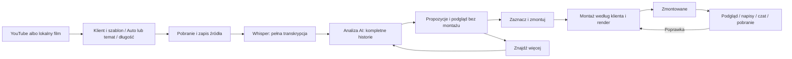

# Założenia funkcji QuickContent

Data założeń: **2026-10-14**. Stan **2026-10-15: kod i GUI zaimplementowane, pełny odbiór trwa**. To kontrakt funkcji; rzeczywiście sprawdzone zachowania i otwarte punkty opisuje [raport odbioru](docs/quickcontent/acceptance.md).

Dokument nadrzędny dla funkcji. [Plan wdrożenia](plan-wdrozenia-QuickContent.md), [projekt GUI](docs/quickcontent/gui.md), [research OpusClip](docs/quickcontent/opusclip-research.md), [źródła techniczne](docs/quickcontent/technical-sources.md), [audyt repo](docs/quickcontent/repo-audit.md), [instrukcje agentów](AGENTS.md).

## 1. Efekt dla użytkowniczki

Wklejam link YouTube albo wgrywam film, wybieram klienta i szablon, temat lub Auto oraz długość. Klikam „Przetwarzaj” i wracam do pracy. Panel zapisuje materiał, transkrybuje i proponuje wszystkie znalezione, sensowne historie. Oglądam propozycje, czytam, o czym mówią i dlaczego warto je wybrać. Zaznaczam wybrane i klikam „Zmontuj zaznaczone”. Widzę postęp każdej rolki oraz liczbę gotowych. Gotowy fragment otwieram, poprawiam napisy lub zlecam zmianę na czacie, następnie pobieram aktualny film.



**Wymagania użytkowniczki:** opisany przepływ, pobranie osobno obrazu i audio, Whisper, wybór klienta/brandingu, Auto lub temat, preferowana długość, propozycje przed montażem, „Znajdź więcej”, opis/ocena, montaż zaznaczonych, postęp, badge i edytor.

**Propozycje projektowe autora:** poniższe zakresy długości, progi oceny, formaty danych, domyślne kadrowanie i kolejka. Mogą być dostrojone po benchmarku; nie przedstawiam ich jako zatwierdzonych wcześniej przez użytkowniczkę ani jako istniejących możliwości.

## 2. Wzorujemy przepływ na OpusClip

Oficjalne materiały potwierdzają import YouTube/pliku, wskazówki do wyszukiwania, ocenę klipów, szablony marki i edycję napisów. QuickContent zachowuje taki układ pracy, ale pierwszy proces kończy się propozycjami bez montażu. [Research z bezpośrednimi źródłami](docs/quickcontent/opusclip-research.md).

„1:1” oznacza tutaj podobną wygodę i przebieg opisany w zleceniu. Nie zakładamy identyczności modeli, liczby wyników, działania każdego ekranu ani całego ClipAnything. Czat do poprawek i jawne oczekiwanie na zaznaczenie są wymaganiami QuickContent. Wersja podstawowa ocenia przede wszystkim mowę; sceny bez dialogu i śledzenie aktywnego mówcy to późniejsze rozszerzenie.

## 3. Zakres pierwszego pełnego wydania

Wszystkie funkcje z §1 muszą działać przez `npm run ui`, w tym YouTube i lokalny upload, klient opcjonalny, poprawki oraz pobranie. Etapy implementacji mogą być częściowe, ale sama biblioteka propozycji nie kończy całej funkcji.

Środowisko: lokalny panel jednej użytkowniczki, obecny React/Vite/Node/Remotion, lokalne pliki i procesy. Podstawowe źródła: ukończone filmy z mową, wywiady, podcasty, wykłady. Bez kont wieloosobowych, automatycznej publikacji, nowej platformy chmurowej i nowego płatnego API. Źródła live trwające w tej chwili, playlisty i dowolne strony poza YouTube nie wchodzą do pierwszej wersji. Materiał wymagający niedostępnego dostępu zgłasza czytelny błąd oraz możliwość wgrania lokalnej kopii.

## 4. Import i przechowywanie

### Formularz

| Pole | Zachowanie |
|---|---|
| Źródło | Zakładki „Link YouTube” i „Wgraj film”; jeden film na projekt |
| Klient | Istniejący klient albo „Bez klienta — przestrzeń robocza”; tworzenie klienta używa obecnego GUI |
| Branding/szablon | Lista zgodnych, zarejestrowanych szablonów klienta; bez klienta domyślnie `persona` |
| Analiza | Domyślnie Auto; po wybraniu „Moje tematy” wymagane tekstowe wskazówki |
| Długość | Domyślnie 30–60 s; opcje 15–30, 30–60, 60–90, 90–180 s, Auto 15–180 s lub własny zakres 10–300 s |
| Jakość źródła YouTube | 1080p domyślnie albo 4K; informacja o faktycznie pobranej jakości |
| Przycisk | „Przetwarzaj”; nie uruchamia montażu żadnej rolki |

Szablon zawiera `id`, `label`, `styleId`, dozwolone `clientIds` lub wariant ogólny, odnośniki do istniejących assetów i wersję. Klient nie oznacza automatycznie gotowego szablonu: GUI musi wskazać brak konfiguracji. Nie kopiujemy szablonu innego klienta. Preferencje wybranego klienta mają pierwszeństwo przed szablonem, ogólnymi preferencjami i `frame.md`.

### Kolejność pobierania YouTube

1. Normalizuj do pojedynczego identyfikatora YouTube i pobierz metadane bez filmu: tytuł, kanał, długość, formaty, język ścieżki. Tytuł zachowaj w oryginalnym brzmieniu jako dane.
2. Wybierz **strumień obrazu bez audio**: najlepszy do limitu 1080p lub 2160p; dla pionowego źródła uwzględnij jego orientację. Zapisz faktyczne wymiary, kodek i format ID. Gdy wybrana jakość nie istnieje, użyj najlepszej niższej i pokaż ostrzeżenie. Nie skaluj mastera w górę.
3. Osobno pobierz najlepszy dostępny **strumień audio bez obrazu**, preferując oryginalną ścieżkę językową filmu; nie przetwarzaj jej po drodze do MP3. Zapisz format ID, kodek, kanały i język.
4. FFmpeg łączy te dwa pliki do `source.mkv` z kopiowaniem strumieni. ffprobe sprawdza obecność obrazu i dźwięku, długość i synchronizację. Brak któregoś wymaganego strumienia kończy import błędem, bez cichego przejścia na słaby plik zespolony.
5. Zachowaj gotowy master lokalnie. Stwórz osobny proxy H.264/AAC MP4 SDR z `faststart` do oglądania; zgodność przeglądarki nie może wymuszać pogorszenia mastera. Metadane opisują każdą konwersję.

Upload lokalny: strumieniowy zapis `.part`, zakończenie atomowe, zachowanie oryginalnego pliku, kontrola ffprobe i utworzenie proxy. Tytuł początkowy z nazwy pliku, edytowalny w GUI. Nie rozdzielamy i nie łączymy ponownie poprawnego lokalnego filmu bez potrzeby.

```text
.quickcontent/
  projects/<projectId>.json         # ustawienia, propozycje, referencje i rewizja
  jobs/<jobId>.json                 # trwały stan każdego zadania
  jobs/<jobId>.events.jsonl         # postęp i zdarzenia bez sekretów
  uploads/<uploadId>.part           # wyłącznie podczas uploadu
  workspace/<projectId>/            # dane źródła, gdy clientId = null
klienci/<clientId>/QuickContent/<projectId>/
  source.mkv                       # YouTube; lokalny plik ma własne rozszerzenie
  metadata.json
  proxy.mp4
  audio/asr.wav                    # kopia do ASR, nie najlepszy oryginał audio
  transcript.raw.json               # niezmieniony wynik Whisper
  transcript.words.json            # stabilne id słów i czasy mastera
  analysis/<analysisRunId>.json     # pokrycie, wyniki i powody odrzucenia
  thumbnails/<candidateId>.jpg
public/reels/qc-<shortProjectId>-<candidateId>/
  source.mp4                       # dopiero po wyborze: dokładny krótki wycinek
  transcript.json                 # czasy lokalnego wycinka
  origin.json                     # powiązanie z masterem i id słów
  reel.json
klienci/<clientId>/Render/qc-…-v001.mp4
out/qc-…-v001.mp4                  # bez klienta
```

Dane źródła bez klienta mają tę samą strukturę pod `workspace/`. Manifest projektu przechowuje ścieżki względne względem repo. ID nadaje backend; tytuł, prompt i nazwa pliku nie są ścieżkami ani poleceniami. Katalogi prywatnych danych i audio obejmuje `.gitignore`. Brak miejsca na dysku zatrzymuje proces przed kolejnym dużym zapisem. Masterów i gotowych wersji nie usuwamy automatycznie; tymczasowe osobne strumienie można sprzątnąć dopiero po kontroli mastera i zapisanym checkpointcie.

## 5. Transkrypcja przez Whisper

Pierwszy adapter używa już dostępnego OpenAI Whisper CLI, modelu `large-v3-turbo`, `--language pl`, `--task transcribe`, JSON i czasów słów. Nie używamy Parakeeta dla QuickContent. Wybór języka można zmienić w ustawieniach zaawansowanych; bez tłumaczenia wypowiedzi. Nie zmieniamy dotychczasowej transkrypcji zwykłych rolek.

Z mastera tworzona jest kopia mono PCM 16 kHz do ASR. Wydajność i czasy słów wymagają pomiaru na tym komputerze. Cache jest związany z hashem audio, modelem, językiem i opcjami, nie z samą nazwą filmu. Zmiana tematu albo „Znajdź więcej” korzysta z istniejącej transkrypcji.

Wynik normalizujemy do słów `{id, text, start, end, probability?}` i segmentów zdań. Walidacja odrzuca NaN, zakres poza źródłem, cofające się czasy i brak rzeczywistej mowy. Nakładanie czasów końców sąsiednich słów może być ostrzeżeniem, nie pretekstem do zmiany surowego ASR. Pusta mowa daje stan „Nie znaleziono wypowiedzi”, nie błąd montażu. Niska pewność nazw, liczb i fragmentów trafia do kontroli użytkowniczki. Nie zgadujemy brakujących zdań.

## 6. Analiza i kompletne fragmenty od A do Z

**Whisper transkrybuje; osobny moduł analizy AI wybiera historie.** Analiza używa operatora i modelu ustawionego w obecnym panelu. Nie zmienia automatycznie dostawcy ani nie dodaje nowej usługi. W GUI jest informacja, że materiał jest zapisany lokalnie, a tekst analizy może zostać przekazany obecnemu dostawcy AI.

1. Utwórz mapę tematów całego filmu i kontekstu rozmowy. Nie analizuj tylko pierwszych kilku minut ani pojedynczego fragmentu wrzuconego do kontekstu modelu.
2. Podziel pełną transkrypcję na okna około 180 s z 30 s zakładki, rozszerzając do granic zdań. Każde okno dostaje mapę tematów i sąsiedni kontekst. Zapisuj pokrycie, aby znać części faktycznie przeanalizowane.
3. AI wskazuje `firstWordId` i `lastWordId`, tytuł, streszczenie, temat, rodzaj wypowiedzi, uzasadnienie i kryteria jakości. Model nie wymyśla czasów; backend wyprowadza je z istniejących słów. Dowód stanowią ID słów z wypowiedzi, nie niezwiązane cytaty.
4. Drugi przegląd czyta także zdania przed i po kandydacie: ustala referenty („to”, „on”, „wtedy”), zależność od pytania, zapowiedź i domknięcie. W razie potrzeby rozszerza **ciągły zakres** albo odrzuca kandydata. Nie skleja oddalonych zdań w nowe znaczenie.
5. Kod weryfikuje granice, długość, poprawne ID, kompletność ocen i duplikaty. Przed prezentacją trzeba zaliczyć bramkę jakości poniżej.

### Bramka jakości

Ocena każdej cechy 0–5: zrozumiałe otwarcie, samodzielność kontekstu, rozwinięcie, domknięcie. Każda musi mieć ≥3. Wszystkie poniższe warunki są również obowiązkowe:

- wypowiedź ma samodzielny przekaz i prawdziwy temat;
- początek/koniec nie wypada wewnątrz słowa lub urwanego zdania;
- wycinek nie usuwa negacji, zastrzeżenia, ironii, istotnego pytania ani odpowiedzi zmieniającej sens;
- tytuł i opis opisują to, co rzeczywiście pada;
- kandydat mieści się w wybranym zakresie długości.

Dodaj 0,15 s zapasu przed pierwszym słowem i 0,25 s po ostatnim, ograniczając do pliku i nie przecinając sąsiedniej mowy. Długość liczona **łącznie z zapasem**. Gdy historia wymaga 67 s przy wyborze 30–60 s, nie urywaj jej: zapisz powód odrzucenia i pokaż propozycję zmiany zakresu. Wyjątek nie przechodzi automatycznie; użytkowniczka może zmienić ustawienie i ponownie szukać. Progi są wersjonowane i kalibrowane na realnych materiałach.

### Ocena redakcyjna

`score = round(100 * (0.25*hook + 0.30*value + 0.20*emotion + 0.15*novelty + 0.10*focusMatch) / 5)`. Składowe 0–5. W Auto `focusMatch` ocenia zgodność z rozpoznanym głównym tematem, nie brak promptu. Nowość dotyczy wypowiedzi w danym filmie; nie udajemy znajomości aktualnych trendów z analizy tekstu.

W GUI nazwa **„Ocena redakcyjna”**, nie prawdopodobieństwo virala lub liczba przyszłych wyświetleń. Wynik służy do sortowania, nie omija bramki kompletności. Karta podaje także `confidence: low|medium|high`, charakter np. „mocna opinia”, „porada”, „historia”, „kontrargument”, „kontrowersyjna teza”, oraz wyjaśnienie „Mocne zdanie o…”. Kontrowersja wynika z treści; nie dopisujemy jej dla klikalności. Ryzyko utraty kontekstu i wątpliwości ASR są opisane.

### Liczba wyników i „Znajdź więcej”

Pierwszy przebieg prezentuje **wszystkie unikalne propozycje spełniające bramkę**, bez stałego celu typu „10 rolek”. Paginacja GUI nie jest limitem analizy. Nie gwarantujemy znalezienia wszystkich możliwych historii w filmie ani dodatniego wyniku dla każdego źródła.

Duplikat: taki sam zakres lub ta sama główna teza plus nakładanie `intersection / shorterDuration >= 0.70`; drugi wariant granic tej samej historii grupujemy zamiast pokazywać jako nową rolkę. Różne, samodzielne tezy mogą częściowo korzystać z tych samych zdań. Zachowujemy powód połączenia/odrzucenia; próg jest testowaną propozycją.

„Znajdź więcej” tworzy kolejny `analysisRunId`: szuka alternatywnych pełnych historii i niedostrzeżonych tematów na tej samej transkrypcji, zna poprzednie zakresy i tezy. Nie powtarza pobrania/ASR, nie kasuje odrzuconych, zaznaczonych ani gotowych klipów, nie obniża automatycznie bramki. Nowy prompt lub długość tworzy nowy przebieg z własnymi ustawieniami. Brak nowych wyników ustawia `exhausted` dla tego zestawu ustawień: „Nie znaleziono kolejnych kompletnych fragmentów”; ponowienie bez zmiany ustawień jest zablokowane, a zmiana tematu/długości odblokowuje szukanie. Błąd lub przerwany przegląd nie oznacza wyczerpania materiału.

## 7. Propozycje i dopiero potem montaż

Propozycja ma miniaturę, tytuł, opis w 1–3 zdaniach, temat/rodzaj, ocenę i uzasadnienie, pewność, zakres w źródle, długość oraz podgląd. Podgląd odtwarza wybrany zakres wspólnego proxy z HTTP Range; nie wypala napisów, grafiki ani brandingu. Przed selekcją nie tworzymy `reel.json` ani kompozycji Studio dla wszystkich kandydatów.

Zaznaczenie jest zapisane w projekcie. „Zmontuj zaznaczone (N)” przekazuje zamrożoną listę ID; tylko one tworzą zadania. Serwer odrzuca obce ID i zdublowany request nie uruchamia drugiego montażu. „Zaznacz wszystkie” obejmuje jawnie wszystkie wyniki bieżącego filtra, z widoczną liczbą; nie ogranicza się przypadkiem do strony wyników. Sortowanie: ocena, czas źródła, długość. Filtry: temat, rodzaj, status, zaznaczone.

### Adapter do istniejącego silnika

Wybrana propozycja dostaje **dokładny krótki plik `source.mp4`** z mastera, kodowany do CFR/SDR i zgodnych kodeków. Reużywamy `buildReel()` i istniejące style/overlays. Nie uruchamiamy ponownie głównego prepa z Parakeetem. Czasy w `reel.json` pozostają sekundami pliku wskazanego przez `source` — tutaj krótkiego wycinka. `localTime = masterTime - origin.sourceStart`. Powiązanie ID słów i globalnego zakresu trafia do `origin.json`.

To eliminuje obecne ryzyko SkyClass: jego audio startuje od początku `source`, więc nie wolno podstawić pełnego długiego mastera z segmentem zaczynającym się w środku. W wycinku SkyClass zachowuje całą wybraną wypowiedź, pauzy, urwane słowa wewnątrz zakresu i napisy 1:1. Inne style mogą później ciąć ciszę/powtórzenia zgodnie z klientem, bez zmiany przekazu.

### Materiał poziomy i branding

Render domyślnie 1080×1920, 30 fps; master może mieć 4K. Dla źródła poziomego automatyczny bezpieczny tryb **fit** zachowuje cały obraz na tle z rozmytego źródła. Dla pionowego domyślnie obecne cover. Edytor pozwala wybrać crop i przesunąć jego środek; pierwsze wydanie nie obiecuje automatycznego śledzenia aktywnego mówcy. Użycie center crop bez kontroli dla rozmowy dwóch osób nie spełnia odbioru.

Opcjonalne `framing: {mode: fit|crop, centerX, centerY}` w `ReelData`, wartości środka znormalizowane 0–1. Stare rolki bez pola zachowują obecny wygląd. `face.bottom` i strefy tekstu trzeba oceniać w kadrze wynikowym po cropie/zoomie. Montaż stosuje klienta, fonty, hooki, grafiki, SFX i zasady researchu z repo, kontrolując twarz i strefę bezpieczną. Szablon/prefs zapisujemy w snapshotcie montażu; zmiana szablonu nie zmienia wcześniej gotowych rolek bez jawnego ponownego montażu.

## 8. Kolejka, postęp i odporność

Trwałe JSON i dziennik zdarzeń; jeden worker ciężkiego zadania QuickContent na początku. Zapis przed uruchomieniem procesu, atomowa aktualizacja manifestu i serializacja `syncStudio()`. Otwarte przeglądarki obserwują zadania przez polling 1–2 s podczas pracy i 4 s bibliotekę; zamknięcie karty ich nie zatrzymuje. Uśpienie komputera może wstrzymać lokalną pracę.

Stan joba: `queued → running → completed|failed|cancelled|interrupted|blocked`. `completed` jest kanonicznym sukcesem workera; stan `AnalysisRun` jest osobny. Etap procesu importu: `metadata → video → audio → mux → proxy → transcribe → analyze → proposals`. Proces wyboru: `materialize → montage → review → render → verify`. Każde zadanie ma `stage`, `completedUnits`, `totalUnits`, `progress` 0–1 lub null, heartbeat, checkpoint i błąd z działaniem naprawczym.

Nie symulujemy procentów zegarem. Pobranie: bajty/całość, jeśli znane. FFmpeg: przetworzony czas/długość. ASR: ukończone fragmenty lub null przy CLI bez wiarygodnego parsera. Analiza: okna przeanalizowane/wszystkie. AI montaż: etap i null. Render: rzeczywisty postęp renderera. Przy etapie z null ekran pokazuje nazwę etapu i czas od startu.

**Wymagany procent montażu partii:** `ukończone aktualne rendery / wszystkie wybrane rolki * 100`. To mierzalny postęp partii, np. „Zmontowane 3/8 — 37,5%”, a obok „Bieżąca rolka: render 72%” lub „AI montuje — brak pomiaru procentowego”. Błędy nie liczą się jako zmontowane; panel osobno pokazuje „1 błąd”. Nie nazywamy tego szacowaniem pozostałego czasu pracy.

Restart nie kontynuuje fikcyjnego `running`: worker ma wyłączną blokadę, zapisuje PID/heartbeat i podczas odzyskania sprawdza własne procesy. Osierocony proces zostaje bezpiecznie zatrzymany przed retry; sam numer PID nie daje prawa zabicia innego procesu. Zakończone checkpointy z poprawnymi artefaktami są reużywane. Nierozstrzygnięty proces blokuje retry z czytelnym statusem. Anulowanie zatrzymuje drzewo procesów danego zadania; zapisane źródło i gotowe inne rolki zostają. Retry wznawia od ostatniego sprawdzonego etapu, nie renderuje ponownie gotowych pozycji partii.

## 9. Edycja, czat i aktualność pliku

Po montażu otwieramy obecny Player/Inspector, z powrotem do projektu QuickContent. Zakładki: napisy, kadrowanie, grafiki, czat i render/pobranie. Ręczna korekta zmienia tekst, nie czasy. Każda zmiana jest zapisana, możliwe cofnięcie; surowy Whisper i master pozostają niezmienne. Czat dotyczy konkretnej rolki, log jest trwały; korekta zwiększa rewizję i jest widoczna w podglądzie.

Każda edycja zwiększa `editRevision`. Render używa zamrożonego snapshotu i ma `renderRevision` oraz podpis danych, stylu, assetów i fontów. Zapis wyniku wersjonowany `v001`, `v002`… bez nadpisywania wcześniejszego MP4. Zmiana wspólnego stylu/fontu również unieważnia aktualność podpisu. Równoległa zmiana podczas renderu pozostawia wynik starej rewizji, nie aktualny badge.

Dla rolki z `origin.json` **wszystkie** istniejące akcje `/api/job/:name` (montage/chat/render, status i anulowanie) przechodzą przez most do trwałego workera QuickContent. Nie mogą uruchomić starego renderu nadpisującego `<name>.mp4` ani ponownego prepa. Operator wykonuje redakcję; także render zamówiony w czacie uruchamia kontrolowany pipeline. Po każdym zakończeniu pracy operatora, również błędzie lub anulowaniu, porównanie danych wykrywa częściowe edycje i aktualizuje rewizję. Osobna kompozycja renderu snapshotu musi przetrwać regenerację `src/Root.tsx` przez `scripts/studio-sync.mjs`.

**„Zmontowane”** wymaga: poprawny MP4 istnieje, ffprobe potwierdza obraz/audio i długość, `renderRevision === editRevision`, podpis nadal odpowiada wejściu. Po poprawce: **„Zmiany do wyrenderowania”**, przycisk „Renderuj poprawki”. Pobranie aktualnej wersji dostępne po aktualnym renderze; poprzednia może być pobrana jako jawnie „Wersja wcześniejsza”. Nie uznajemy samego zakończenia operatora za gotowy film.

## 10. Minimalny kontrakt danych i API

Typy logiczne są wspólne dla schematu backendu i UI; walidacja przez obecne Zod. ID są nieprzezroczyste, nadawane na serwerze. `revision` projektu służy do zapisu optymistycznego i jest czym innym niż `editRevision` konkretnej rolki.

`focus = {mode: "auto"|"prompt", prompt?: string}`; dla prompt tekst nie może być pusty. `duration = {min: number, max: number}` w sekundach. `sourceKind = "youtube"|"upload"`; jakość `resolution = 1080|2160` dotyczy tylko pobrania YouTube. Status Candidate: `proposed|queued|materializing|montaging|reviewing|rendering|completed|failed|cancelled`; aktualność ukończonego wyniku jest dodatkowo wyliczana z rewizji i podpisu, nie samym statusem.

| Zasób | Wymagane dane |
|---|---|
| Project | `id`, `revision`, `title`, `sourceKind`, `clientId: string|null`, `templateId`, `focus`, `duration`, `resolution`, `source`, `analysisRuns`, `candidates`, `selectedCandidateIds`, `batchIds` |
| Source | `id`, `masterPath`, `proxyPath`, `metadataPath`, `hash`, `duration`, `width`, `height`, `audioLanguage`, `transcriptHash` |
| Candidate | `id`, `analysisRunId`, `firstWordId`, `lastWordId`, `sourceStart`, `sourceEnd`, `title`, `summary`, `topic`, `kind`, `score`, `scoreBreakdown`, `completeness`, `confidence`, `reason`, `contextRisk`, `status`, `reelName?`, `editRevision`, `renders` |
| AnalysisRun | `id`, `focus`, `duration`, `settingsKey`, `coverage`, `candidateIds`, `status`, `exhausted`, `rejections` |
| Batch | `id`, `candidateIds` zamrożone, `jobIds`, `completed`, `failed`, `cancelled`, `total` |
| Job | `id`, `projectId`, `candidateId?`, `batchId?`, `kind`, `status`, `stage`, `progress`, `completedUnits`, `totalUnits`, `checkpoint`, `attempt`, `heartbeat`, `error?` |

| Endpoint | Kontrakt |
|---|---|
| `GET /api/quickcontent/templates` | Zarejestrowane szablony i gotowość per klient |
| `POST /api/quickcontent/uploads` | Strumień filmu; odpowiedź `{uploadId}` po sprawdzeniu pliku |
| `GET/POST /api/quickcontent/projects` | Lista / utworzenie projektu; POST JSON `sourceKind`, `url` lub `uploadId`, `clientId`, `templateId`, `focus`, `duration`, `resolution` |
| `GET /api/quickcontent/projects/:id` | Projekt, propozycje, wybór i stan partii |
| `POST /api/quickcontent/projects/:id/process` | Uruchom import+ASR+analizę; odpowiedź `{jobId}` |
| `POST /api/quickcontent/projects/:id/find-more` | `{expectedRevision, focus?, duration?}`; kolejny przebieg, odpowiedź `{jobId, analysisRunId}` |
| `PUT /api/quickcontent/projects/:id/selection` | `{candidateIds, expectedRevision}`; zapis wyboru, nowa rewizja |
| `POST /api/quickcontent/projects/:id/montage` | `{candidateIds, expectedRevision, idempotencyKey}`; odpowiedź `{batchId, jobIds}` |
| `GET /api/quickcontent/jobs/:jobId?after=<cursor>` | Stan oraz przyrost zdarzeń |
| `POST /api/quickcontent/jobs/:jobId/cancel` | Anulowanie wskazanego zadania; partia ma akcję anulującą wszystkie jej niegotowe joby |
| `POST /api/quickcontent/jobs/:jobId/retry` | Retry tego samego celu od checkpointu; nowy attempt |
| `GET /api/quickcontent/projects/:id/media/proxy` | Proxy z HTTP Range, tylko plik powiązany z projektem |
| `GET /api/quickcontent/projects/:id/media/thumbnails/:candidateId` | Miniatura tylko własnej propozycji, bez dowolnej ścieżki |
| Istniejące `/api/reel`, `/api/job`, `/api/file` | Edycja/Player/czat i pobranie po materializacji; adapter dopisuje rewizje QuickContent |

JSON ma limit 1 MiB i schematy; plik filmowy jest strumieniem. Wszystkie mutacje zachowują sprawdzenie `X-Panel` i Origin obecnego panelu. Źródło YouTube jest normalizowane do dozwolonego hosta; backend nie przyjmuje dowolnego URL do fetch. Pliki wideo, tytuły, prompty i transkrypcja są danymi, nie instrukcjami dla operatora; analiza ma uprawnienia tylko do odczytu i własnego wyniku. Montaż może zmieniać jedynie wskazaną rolkę. Ścieżki sprawdzamy także przez `realpath`, aby symlink nie wychodził poza dozwolony katalog. Konflikt rewizji: HTTP 409 i odświeżenie danych, bez nadpisania poprawek. Brak klienta po usunięciu folderu: blokada z wyjaśnieniem, nie ciche przeniesienie danych.

## 11. Warunki odbioru całości

1. YouTube dostarcza osobno obraz i audio, metadane oraz poprawny master w katalogu klienta lub workspace; upload działa także bez klienta.
2. Przetwarzanie w tle kończy się propozycjami, bez wywołania montażu, nowych kompozycji i renderów.
3. Każda propozycja ma opis, rodzaj, uzasadnioną ocenę, pełny przekaz i podgląd zgodny ze źródłem.
4. „Znajdź więcej” zachowuje wybór i gotowe pliki; nowe wyniki są unikalne, a brak dalszych wyników jest uczciwie pokazany.
5. Montaż obejmuje tylko zaznaczone ID i właściwe zasady klienta. SkyClass z fragmentu zaczynającego się po 0 s ma zgodne audio i pełną wypowiedź.
6. GUI pokazuje etap, gotowe X/Y i procent partii, a render ma rzeczywisty procent. Refresh nie kasuje projektu; restart kończy się odzyskaniem lub stanem „Przerwane” z bezpiecznym retry.
7. Napisy, czat i kadrowanie działają w GUI. Poprawka nie przesuwa czasów ani nie nadpisuje mastera, a render starej rewizji nie dostaje aktualnego badge.
8. „Zmontowane” wymaga zweryfikowanego, aktualnego MP4. Pobranie, historia wersji i powrót do projektu są czytelne.
9. Materiał poziomy, rozmowa dwóch osób i slajdy pozostają czytelne w 9:16; typografia nie zasłania twarzy i trzyma strefę bezpieczną.
10. Obecne zwykłe rolki, style klientów i Motion Studio działają jak przed wdrożeniem. Testy, typy i kontrola GUI przechodzą; brak limitu wyników ukrytego w paginacji.

## 12. Otwarte pomiary, nie blokady dokumentacji

Przed wydaniem zmierzyć ASR na realnym polskim audio, jakość granic/ocen oraz transfer i pamięć 4K. Ustawienia analizy dobieramy do obecnego operatora; brak benchmarku nie daje podstawy do obietnicy czasu lub kosztu. Brak pewnego timestampu/pełnej historii kończy się ostrzeżeniem lub odrzuceniem, nie sztucznym wynikiem.

Docelowe późniejsze rozszerzenia: analiza obrazu i dźwięków pozamownych, automatyczne śledzenie mówcy, split screen oraz eksport 4K. Nie są potrzebne, aby dowieźć zamówiony podstawowy przepływ, i nie powinny opóźniać lokalnego modułu.
